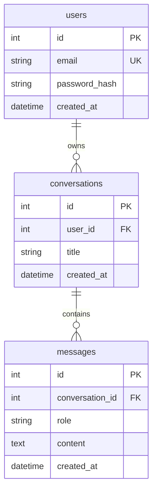

# Security and Persistence Report

## 1. Database Schema

The application connects to a SQLite database (`sqlite:///./app.db` by default, configurable via `DATABASE_URL`) using SQLAlchemy (`app/database.py`) and defines three relational tables in `app/models.py`:

### Tables
- **`users`**:
  - `id` (Integer, primary key, indexed)
  - `email` (String(255), unique, indexed, not null) — normalized to lowercase on write and lookup
  - `password_hash` (String(255), not null) — stores only the `bcrypt` salted hash, never the plaintext password
  - `created_at` (DateTime with UTC timezone)
- **`conversations`**:
  - `id` (Integer, primary key, indexed)
  - `user_id` (Integer, foreign key to `users.id` with `ON DELETE CASCADE`, indexed, not null)
  - `title` (String(200), not null)
  - `created_at` (DateTime with UTC timezone)
- **`messages`**:
  - `id` (Integer, primary key, indexed)
  - `conversation_id` (Integer, foreign key to `conversations.id` with `ON DELETE CASCADE`, indexed, not null)
  - `role` (String(32), not null) — `"user"` or `"assistant"`
  - `content` (Text, not null)
  - `created_at` (DateTime with UTC timezone)

Both the user's message and the generated assistant reply are persisted atomically within a single SQLAlchemy transaction (`db.add_all([user_msg, assistant_msg]); db.commit()`) when starting a conversation with an initial message or posting to `POST /conversations/{conversation_id}/messages`.

---

## 2. Authentication Flow

Authentication is implemented in `app/auth.py` and wired into `app/main.py`:

1. **Registration (`POST /auth/register`)**:
   - Normalizes the email address (`strip().lower()`), checks for existing accounts (returning `409 Conflict` on duplicates), hashes the password with `bcrypt.hashpw(password.encode("utf-8"), bcrypt.gensalt())`, and persists only `password_hash`.
   - The response schema (`UserResponse`) exposes `id`, `email`, and `created_at`, never `password_hash`.
2. **Login (`POST /auth/login`)**:
   - Looks up the user by normalized email and verifies the submitted password against `user.password_hash` using `bcrypt.checkpw`.
   - Invalid credentials return `401 Unauthorized`.
   - Valid credentials issue a signed HS256 JWT (`create_access_token`) containing `sub` (user ID), `email`, `iat`, and `exp` (60 minutes by default).
3. **Current-User Dependency (`get_current_user`)**:
   - Uses FastAPI's `HTTPBearer(auto_error=False)` to extract the `Authorization: Bearer <token>` header.
   - Decodes and validates the JWT signature and expiration using `PyJWT`. Missing headers, invalid signatures, expired tokens, or deleted user IDs raise `401 Unauthorized` with `WWW-Authenticate: Bearer`.
   - Protected routes (`/auth/me`, `/conversations`, `/conversations/{conversation_id}`, `/conversations/{conversation_id}/messages`) depend on `get_current_user`.

---

## 3. Ownership Rule

Every conversation belongs to a single user via `conversations.user_id`. Access control is enforced in two ways in `app/main.py`:

1. **Listing (`GET /conversations`)**:
   - Queries explicitly filter by `Conversation.user_id == current_user.id`, so User A never sees User B's conversation IDs or titles.
2. **Single-Resource Read and Write (`_get_owned_conversation`)**:
   - Used by both `GET /conversations/{conversation_id}` (reading messages) and `POST /conversations/{conversation_id}/messages` (modifying the conversation by appending messages).
   - Fetches the conversation by `id`. If it does not exist, raises `404 Not Found`.
   - Checks `if conversation.user_id != current_user.id:` and raises `403 Forbidden` (`"Not authorized to access this conversation"`).
   - Because ownership is verified before reading messages or inserting new records, User A can neither inspect nor mutate User B's conversations.

---

## 4. Temporary Cache vs. Permanent Database

`app/cache.py` includes an in-memory TTL cache (`InMemoryTTLCache`, 300-second TTL, 256-entry bound) used in `generate_assistant_reply` exclusively for repeated, non-sensitive FAQ prompts (`NON_SENSITIVE_FAQ`), keyed by a SHA-256 digest of the normalized prompt:

- **Why the cache is temporary**: The cache lives in process RAM with a fixed TTL and size cap. Entries expire automatically, are evicted when capacity is reached, and disappear completely on process restart or worker scaling. If swapped for Redis in production, it remains an ephemeral optimization layer with eviction and TTL policies. Sensitive user-specific prompts are intentionally excluded from shared caching to prevent cross-user data leakage.
- **Why the database is permanent**: SQLite (via SQLAlchemy) writes committed `User`, `Conversation`, and `Message` rows to disk with relational integrity (`FOREIGN KEY` constraints) and durability. Even when `ai_response_cache.clear()` empties the cache or the server restarts, all conversations and both user and assistant messages remain intact in the database.

---

## 5. Test Proving Private Data Protection

`tests/test_app.py` includes `test_private_data_protection_ownership_check`, which proves that one authenticated user cannot read or modify another user's private conversations:

1. Registers and logs in **User A** (`usera@example.com`) and **User B** (`userb@example.com`), obtaining separate JWT tokens (`token_a` and `token_b`).
2. User B creates a conversation (`POST /conversations`) titled `"User B Private Notes"` with `initial_message: "My private secret"`, receiving `conv_b_id`.
3. User A calls `GET /conversations` and receives `[]`, confirming User B's conversation is excluded from User A's list.
4. User A attempts to read User B's conversation via `GET /conversations/{conv_b_id}` and receives **`403 Forbidden`**.
5. User A attempts to modify User B's conversation by appending a message via `POST /conversations/{conv_b_id}/messages` and receives **`403 Forbidden`**.
6. User B calls `GET /conversations/{conv_b_id}` and receives **`200 OK`** with the original 2 messages intact (`"My private secret"` and the assistant's reply), proving no unauthorized read or tampering occurred.
